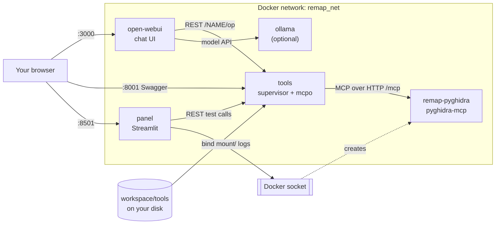
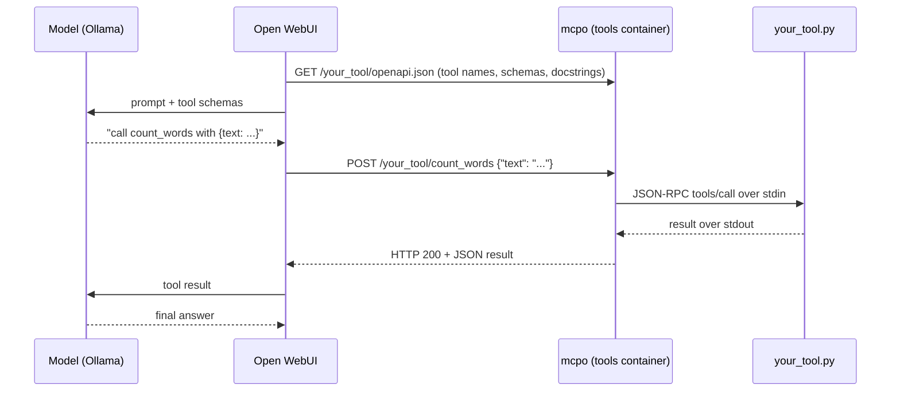

# How REMAP Works

This page explains how the containers, files and processes fit together. It is a resource for anyone who wants to change the lab,
debug it, or understand what happens between typing a prompt and a tool running.

## The Big Picture



There are four long-running services, defined in [`docker-compose.yml`](../docker-compose.yml), plus one
container the panel creates on demand:

| Container | Image | Runs as | Job |
|-----------|-------|---------|-----|
| `remap-tools` | lab image | your UID (`LAB_UID`) | Runs custom tools and exposes them as REST |
| `remap-panel` | lab image | root | Control panel; the only container with the Docker socket |
| `remap-webui` | `ghcr.io/open-webui/open-webui` | image default | Chat interface |
| `remap-ollama` | `ollama/ollama` | image default | Local model, only with the `local-model` profile |
| `remap-pyghidra` | `ghcr.io/clearbluejar/pyghidra-mcp` | root | Headless Ghidra as an MCP server, started by the panel |

All of them join the `remap_net` network and reach each other by container or service name
(`tools`, `remap-pyghidra`, `ollama`).

## MCP Tools Exposed as REST

Custom tools are ordinary [MCP](https://modelcontextprotocol.io) servers written with the Python SDK's
`FastMCP`. MCP servers usually talk JSON-RPC over stdio, which a chat UI cannot call directly.
[mcpo](https://github.com/open-webui/mcpo) bridges the two: it launches each MCP server, asks it for its tool
list, and publishes every tool as a REST endpoint with an OpenAPI schema.

What happens when the model calls a tool:



This is why the docstring and type hints matter: they become the OpenAPI description and schema the
model sees. It is also why a plain `print()` in a tool causes trouble: stdout is the JSON-RPC channel.

## The Docker Image

One image ([`image/Dockerfile`](../image/Dockerfile)) is used by both `tools` and `panel`; Compose gives
each a different command and user. It installs the Python packages from
[`image/requirements.txt`](../image/requirements.txt) and copies in the supervisor and the panel code.

Pinned versions and why:

| Pin | Reason |
|-----|--------|
| `mcp[cli]>=1.9,<2` | 2.x renamed `FastMCP` and hides exception text from clients |
| `fastapi<0.145` | mcpo 0.0.20 passes `ssl_certfile` to `FastAPI()`, which 0.145 and later reject |

## The Tools Container

The container runs [`image/supervisor.py`](../image/supervisor.py), a small loop that owns one mcpo process.
Every 2 seconds it:

1. **Discovers tools.** Every `workspace/tools/*.py` becomes a route named after the file. Files starting
   with `_` are helpers (importable, not served). `pyghidra` is reserved. A file with a syntax error is
   skipped with a warning in the log, so one broken file does not take the others down.
2. **Checks pyghidra-mcp.** It tries a TCP connection to `remap-pyghidra:8000`.
3. **Computes a fingerprint** of: each tool file's name, size and modification time; whether pyghidra is
   reachable; and the contents of `/state/pyghidra.generation`.
4. **Restarts mcpo** when the fingerprint changes or the file `/state/restart` exists (it deletes that file).
   It writes a fresh `/tmp/mcpo.json` and starts mcpo on port 8000.

The generated mcpo config looks like this:

```json
{
  "mcpServers": {
    "hello": {
      "command": "/usr/local/bin/python",
      "args": ["/workspace/tools/hello.py"],
      "env": {"PYTHONUNBUFFERED": "1"}
    },
    "pyghidra": {
      "type": "streamable-http",
      "url": "http://remap-pyghidra:8000/mcp",
      "headers": {"Host": "localhost:8000"}
    }
  }
}
```

Custom tools are launched by mcpo as child processes over stdio. pyghidra-mcp is a separate container
reached over HTTP. The `Host` header is needed because pyghidra-mcp keeps the MCP SDK's DNS rebinding
protection on, which only accepts `localhost` style hosts.

If mcpo crashes, the supervisor waits 3 seconds and starts it again.

The port is published as `127.0.0.1:8001`, so `http://localhost:8001/hello/docs` is mcpo's Swagger page for
the `hello` route.

## The Panel Container

The panel is a Streamlit app: [`panel/app.py`](../panel/app.py) is the UI, and all logic lives in
[`panel/remap_panel/`](../panel/remap_panel):

| Module | What it does |
|--------|--------------|
| `lib.py` | Pure logic, no Streamlit or Docker: lists tools, reads mcpo's OpenAPI to build the test form, calls tools, manages project folders, writes the state files |
| `ghidra.py` | The only code that uses the Docker API: starts, stops and inspects `remap-pyghidra`, and reads container logs |
| `theme.py` | DSU colors and CSS |

The panel never runs user code. It talks to the tools container the same way Open WebUI does, over HTTP
at `http://tools:8000`. Its **Test a tool** form is built from each route's `openapi.json`.

### Panel and Supervisor Coordination

They share the `remap_state` volume at `/state` and talk through small files:

| File | Written by | Read by | Meaning |
|------|-----------|---------|---------|
| `restart` | panel (**Restart tools**) | supervisor | Restart mcpo now; the supervisor deletes it |
| `pyghidra.generation` | panel (start or stop) | supervisor | pyghidra was replaced; reconnect even if it looked up both times |
| `active_project` | panel | panel | Which project to preselect on the Ghidra tab |

The generation file exists because mcpo holds a session to the old pyghidra container. If the panel replaces it
quickly, the port never appears closed, so without the generation number the supervisor would not notice.

`/state` is mode `0777` in the image because the panel (root) creates files that the tools user must delete.

## pyghidra-mcp

When you press **Start / apply project**, `ghidra.start()`:

1. Lists the binaries in `/projects/<project>/binaries` (and refuses an empty project).
2. Removes any existing `remap-pyghidra` container.
3. Runs a new one from `ghcr.io/clearbluejar/pyghidra-mcp` (override with `PYGHIDRA_IMAGE`) on
   `remap_net`, with the `remap_projects` volume at `/projects`, the label `remap.project=<project>`, and
   restart policy `unless-stopped`. The arguments are:
   ```
   -t streamable-http --host 0.0.0.0 --port 8000
   --project-path /projects/<project>/ghidra --project-name <project>
   /projects/<project>/binaries/<each binary>
   ```
4. Writes `active_project` and bumps `pyghidra.generation`.

pyghidra-mcp imports and analyzes each binary at startup, then builds a search index (the first start also
downloads a small embedding model). Once port 8000 answers, the supervisor adds the `/pyghidra` route.

Project layout on the `remap_projects` volume:

```
/projects/
  <project>/
    binaries/              binaries uploaded from the panel
    ghidra/                Ghidra project files written by pyghidra-mcp
```

The panel creates project folders with mode `0777` so a container running as another user can write to them.

The upstream image is multi-arch (amd64 and arm64), so it runs natively on Apple Silicon.

## Open WebUI and the model

- `TOOL_SERVER_CONNECTIONS` registers `http://tools:8000/hello` and `http://tools:8000/pyghidra` as
  OpenAPI tool servers. Open WebUI reads it **only on first boot**; later changes go through its admin settings
  and are stored in the `openwebui` volume.
- `OLLAMA_BASE_URL` points at either a shared server (from `setup.sh`) or `http://ollama:11434`.
- The `ollama` service only starts when `COMPOSE_PROFILES=local-model` is set in `.env`, which setup does
  when you leave the Ollama URL blank. It starts without any model.

## Storage

| Name | Type | Mounted in | Holds |
|------|------|-----------|-------|
| `./workspace` | bind mount | tools (rw), panel (ro) | Student tool files |
| `remap_state` | volume | tools, panel | Coordination files above |
| `remap_projects` | volume | panel, remap-pyghidra | Ghidra projects and binaries |
| `openwebui` | volume | open-webui | Accounts, chats, tool server settings |
| `ollama` | volume | ollama | Downloaded models |

`docker compose down -v` deletes every volume. `./workspace` is a normal folder and is never deleted.

## Security Boundaries

- **User code has no Docker access.** It runs in `tools`, as a non-root user, with no Docker socket.
- **The panel has full Docker access** through the socket, because it must start pyghidra-mcp. Anyone who can
  use the panel controls the host's Docker. That is why every port is bound to `127.0.0.1` only. Do not
  publish these ports on a shared network.
- **pyghidra-mcp only analyzes binaries**; it does not execute them.

## Configuration

Set in `.env` by `setup.sh` / `setup.ps1`:

| Variable | Used by | Purpose |
|----------|---------|---------|
| `LAB_IMAGE` | compose | Lab image for tools and panel |
| `LAB_UID`, `LAB_GID` | compose | User for the tools container, so files in `workspace/` stay yours |
| `WEBUI_SECRET_KEY` | open-webui | Session signing key (random) |
| `OLLAMA_BASE_URL` | open-webui, panel | Model server |
| `COMPOSE_PROFILES` | compose | `local-model` to start Ollama |

Other environment variables, with defaults, that you rarely need to change: `TOOLS_DIR`, `STATE_DIR`,
`PROJECTS_DIR`, `POLL_SECONDS` (supervisor), `PYGHIDRA_HOST`, `PYGHIDRA_PORT`, `PYGHIDRA_IMAGE`,
`REMAP_NETWORK`, `REMAP_PROJECTS_VOLUME`, `TOOLS_URL` (panel).

## Code Map

```
docker-compose.yml        services, network, volumes, ports
setup.sh, setup.ps1       first-run .env and workspace/tools
image/
  Dockerfile              lab image
  requirements.txt        Python dependencies and pins
  supervisor.py           tools container main loop
panel/
  app.py                  Streamlit UI
  remap_panel/lib.py      panel logic (no Streamlit or Docker imports)
  remap_panel/ghidra.py   Docker API: pyghidra container and logs
  remap_panel/theme.py    DSU colors
tools/hello.py            sample tool copied into workspace/tools
.github/workflows/        builds and publishes the image to ghcr
```
